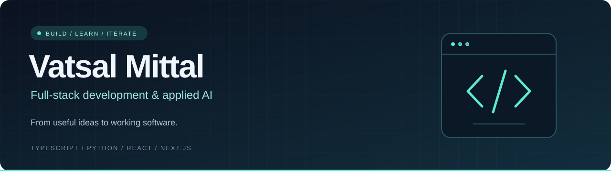

<a href="#about">About</a> &nbsp; / &nbsp;
<a href="#technologies">Technologies</a> &nbsp; / &nbsp;
<a href="#selected-work">Selected work</a> &nbsp; / &nbsp;
<a href="https://github.com/vatsal-mittal-7904?tab=repositories">All repositories</a>

## About

<table>
<tr>
<td width="72%" valign="top">

I build web applications with <b>TypeScript and Python</b>, bringing together interfaces, backend APIs, relational databases, and applied AI.

My work spans conversational commerce, retail operations, multi-agent systems, and planning tools. I focus on the workflows behind the interface: validating inputs, managing transactions, streaming updates, and keeping people involved in AI-assisted decisions.

<b>Across my projects</b>

<ul>
<li>Full-stack applications with React, Next.js, and FastAPI.</li>
<li>Data workflows with PostgreSQL, Prisma, and structured validation.</li>
<li>AI integration through document recognition and agent orchestration.</li>
</ul>
</td>
<td width="28%" align="center" valign="middle">

</td>
</tr>
</table>

## Technologies

<b>Languages</b>

<b>Frontend & APIs</b>

<b>Data & applied AI</b>

## Selected work

<table>
<tr>
<td width="50%" valign="top">

COMMERCE & PAYMENTS

<h3><a href="https://github.com/vatsal-mittal-7904/razorPay_Project">MerchantOS</a></h3>

AI-assisted product discovery connected to Razorpay checkout, with server-side payment and spending rules.

<ul><li>Customer-approved offers and order creation.</li><li>Verified webhooks, reconciliation, and inventory updates.</li></ul>

Next.js · TypeScript · PostgreSQL · Prisma

Architecture &amp; implementation

<ul><li>Server-side discount, margin, and spending limits constrain checkout actions.</li><li>Payment verification and reconciliation connect provider state to order settlement.</li><li>Merchant analytics and campaign workflows include human approval.</li></ul>

Built for the Razorpay Agentic Commerce Hackathon.

</td><td width="50%" valign="top">

RETAIL OPERATIONS

<h3><a href="https://github.com/vatsal-mittal-7904/vatsal-bath-gallery">Vatsal Bath Gallery</a></h3>

A retail management application connecting handwritten orders, product catalogues, billing, and inventory.

<ul><li>Hindi and Hinglish slip recognition with staff review.</li><li>Estimates, invoices, payments, and profit reporting.</li></ul>

Next.js · TypeScript · PostgreSQL · Gemini

Architecture &amp; implementation

<ul><li>Gemini extracts order lines; fuzzy matching proposes catalogue candidates for review.</li><li>Catalogue variants, estimates, and GST invoice calculations support counter operations.</li><li>Transactional stock movements and role-based access separate staff work from owner-only costs and margins.</li></ul>

</td>
</tr>
<tr>
<td width="50%" valign="top">

MULTI-AGENT SYSTEMS

<h3><a href="https://github.com/vatsal-mittal-7904/Neural_Arbiter.">Neural Arbiter</a></h3>

Opposing AI agents debate a topic while a separate model returns structured evaluations and summaries.

<ul><li>Stateful debate rounds and human participation.</li><li>Live transcripts, argument graphs, and evaluation charts.</li></ul>

Python · FastAPI · LangGraph · React

Architecture &amp; implementation

<ul><li>LangGraph manages shared debate state and pauses for human participation.</li><li>FastAPI streams updates over WebSockets to a React dashboard.</li><li>Pydantic structures model evaluations; fallback handling and offline mocks support development.</li></ul>

</td><td width="50%" valign="top">

PLANNING & OPTIMIZATION

<h3><a href="https://github.com/vatsal-mittal-7904/form-flow-ai">Formwork Optimization</a></h3>

A Streamlit simulation of a formwork planning workflow, from geometry inputs to material quantities.

<ul><li>Geometry analysis, clustering, and genetic scheduling.</li><li>Material kitting, quantities, and a feedback stage.</li></ul>

Python · Streamlit · scikit-learn · OR-Tools

Architecture &amp; implementation

<ul><li>Simulates data ingestion and geometry analysis before optimization.</li><li>Explores clustering and genetic scheduling with planning libraries.</li><li>Includes automated kitting, bill-of-quantities generation, and a digital-twin feedback stage.</li></ul>

</td>
</tr>
</table>

<b>Additional tools used across these projects</b>

| Area | Tools & techniques |
| :--- | :--- |
| Validation & testing | Zod, Pydantic, Vitest, offline mock workflows |
| Real-time applications | WebSockets, streaming transcripts, interactive charts |
| Analytics & planning | pandas, NumPy, PyGAD, OR-Tools, Plotly |
| Application workflows | Access control, payment verification, transactional inventory, audit records |

---

<a href="https://github.com/vatsal-mittal-7904?tab=repositories"><b>Explore all repositories</b></a>

